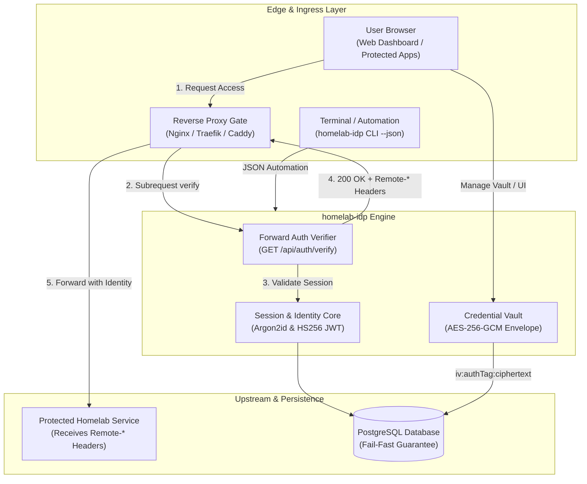

<div align="center">

# homelab-idp

**Self-hosted reverse proxy forward authentication gateway and AES-256-GCM credential vault.**

[](#tech-stack)
[](#tech-stack)
[](#tech-stack)
[](#tech-stack)
[](#features)
[](#features)
[](#quick-start)
[](LICENSE)

[Architecture](#architecture) • [Features](#features) • [Preview](#web-interface-preview) • [Tech Stack](#tech-stack) • [Quick Start](#quick-start) • [CLI & API](#cli--api-reference) • [Proxy Setup](#reverse-proxy-configuration) • [Documentation](#documentation)

</div>

---

> **Built for self-hosters and homelab operators** who need lightweight single sign-on and credential management without the overhead of heavy enterprise suites. `homelab-idp` combines a subrequest forward authentication gate with an authenticated AES-256-GCM password bank in a single container.

---

## Architecture



---

## Features

<table>
  <tr>
    <td width="50%" valign="top">
      <h4>Password Bank & Credential Vault</h4>
      <ul>
        <li><strong>AES-256-GCM Vault</strong>: Authenticated symmetric encryption using unique 12-byte random IVs per secret (<code>iv:authTag:ciphertext</code>).</li>
        <li><strong>Argon2id Security</strong>: High-security account hashing with 64 MB memory cost, 3 iterations, and 4 parallel threads.</li>
        <li><strong>Real-Time Search</strong>: Instant filtering across service names, usernames, URLs, categories, and operational notes.</li>
        <li><strong>Instant Inline Editing</strong>: Edit passwords, URLs, and notes directly in grid or table views without modal recreations.</li>
        <li><strong>Clipboard & Entropy Tools</strong>: One-click copy with toast notifications and built-in password generator.</li>
      </ul>
    </td>
    <td width="50%" valign="top">
      <h4>Forward Auth & Production Gate</h4>
      <ul>
        <li><strong>Subrequest Proxy Gate</strong>: High-throughput <code>GET /api/auth/verify</code> for Nginx Proxy Manager, Traefik, Caddy, and Envoy.</li>
        <li><strong>Identity Header Injection</strong>: Injects <code>Remote-User</code>, <code>Remote-Email</code>, <code>Remote-Name</code>, and <code>Remote-Groups</code> into upstreams.</li>
        <li><strong>Fail-Fast Database</strong>: Crashes immediately (<code>exit 1</code>) on startup if PostgreSQL is unreachable in production.</li>
        <li><strong>Unified Scriptable CLI</strong>: Native <code>homelab-idp</code> CLI with global <code>--json</code> support for headless automation.</li>
        <li><strong>Return Redirection</strong>: Preserves target locations using <code>?rd=&lt;target_url&gt;</code> query parameters.</li>
      </ul>
    </td>
  </tr>
</table>

---

## Web Interface Preview

### Vault Dashboard (Grid View)


### Vault Dashboard (Table View)


---

## Tech Stack

| Layer | Technology | Role |
|---|---|---|
| **Backend Engine** | Fastify 5 + TypeScript | High-throughput asynchronous HTTP server and routing |
| **Frontend UI** | React 19 + Vite 6 + Tailwind CSS 4 | Responsive single-page application with Framer Motion |
| **State & Persistence** | PostgreSQL 16 (`pg`) | Relational schema storage with strict production health check |
| **Cryptography** | AES-256-GCM + Argon2id | Authenticated envelope encryption and salted password hashing |
| **Session & Tokens** | Jose (HS256 JWT) | Compact signed session tokens and forward-auth verification |
| **Containerization** | Docker + Compose | Lightweight Alpine-based deployment on shared network |

---

## Quick Start

### Prerequisites
- Docker Engine 24+ and Docker Compose v2 (or Node.js 20+ for host execution)
- Shared Docker network (e.g. `shared_net`) or local PostgreSQL instance

### Container Deployment (Recommended)

```bash
# 1. Clone the repository and configure environment variables
git clone https://github.com/username/homelab-idp.git
cd homelab-idp
cp .env.example .env

# 2. Ensure shared network exists and build containers
docker network create shared_net || true
docker compose up -d --build

# 3. Confirm health status
curl -s http://localhost:8300/api/health
```

Default dashboard access: `http://<host-ip>:8300` (Default: `admin` / `change_this_master_password`).

### Local Development

```bash
# Install root dependencies and run backend/frontend concurrently
npm install
npm run dev:backend   # Fastify dev server with hot reload on :4000
npm run dev:frontend  # Vite React dev server on :5173
```

---

## CLI & API Reference

Manage users, tokens, and vault credentials via the native `homelab-idp` CLI:

```bash
# User administration
homelab-idp user add --username alice --email alice@homelab.local --password "SecretPass123!" --json
homelab-idp user list --json

# Credential vault management (resolves service names to UUIDs automatically)
homelab-idp vault add --service "Proxmox" --username "root@pam" --password "PveRoot2026!" --category "Infra" --json
homelab-idp vault list --query "proxmox" --reveal --json
homelab-idp vault update "Proxmox" --password "NewPvePassword2026!" --json
homelab-idp vault get "Proxmox" --reveal --json

# Automated token generation & forward-auth verification test
homelab-idp token generate --username admin --hours 24 --json
homelab-idp forward-auth test --token "<jwt_token>" --json
```

### Core API Endpoints

| Method | Endpoint | Description | Auth Required |
|---|---|---|---|
| `GET` | `/api/health` | Container readiness and health probe | None |
| `POST` | `/api/auth/login` | Authenticate username/password and issue session cookie | None (Rate-limited) |
| `GET` | `/api/auth/verify` | Forward authentication proxy subrequest gate | Cookie or Bearer |
| `GET` | `/api/auth/me` | Retrieve profile and role for current session | Session / Bearer |
| `GET` | `/api/vault` | Search and list credentials (supports `?q=query`) | Session / Bearer |
| `POST` | `/api/vault` | Store newly encrypted credential record | Session / Bearer |
| `PUT` | `/api/vault/:id` | Update credentials, category, notes, or URL | Session / Bearer |
| `DELETE`| `/api/vault/:id` | Remove credential entry from vault | Session / Bearer |

---

## Reverse Proxy Configuration

To protect homelab web applications, configure Nginx Proxy Manager (or Nginx) to query `homelab-idp`:

```nginx
# 1. Forward Auth Verification Subrequest
location /npm-auth-verify {
    internal;
    proxy_pass http://homelab-idp:4000/api/auth/verify;
    proxy_pass_request_body off;
    proxy_set_header Content-Length "";
    proxy_set_header X-Original-URI $request_uri;
    proxy_set_header X-Forwarded-For $remote_addr;
    proxy_set_header Host $http_host;
}

# 2. Guard Root Routes and Inject Headers
location / {
    auth_request /npm-auth-verify;

    # Capture identity headers returned by homelab-idp
    auth_request_set $remote_user $upstream_http_remote_user;
    auth_request_set $remote_email $upstream_http_remote_email;
    auth_request_set $remote_name $upstream_http_remote_name;
    auth_request_set $remote_groups $upstream_http_remote_groups;

    # Forward identity headers to protected upstream app
    proxy_set_header Remote-User $remote_user;
    proxy_set_header Remote-Email $remote_email;
    proxy_set_header Remote-Name $remote_name;
    proxy_set_header Remote-Groups $remote_groups;

    # Redirect unauthenticated requests to login
    error_page 401 = @error401;
    proxy_pass $forward_scheme://$server:$port;
}

# 3. Return Redirection Handler
location @error401 {
    return 302 https://idp.yourdomain.com/login?rd=$scheme://$http_host$request_uri;
}
```

---

## Troubleshooting & Operations

| Symptom | Probable Cause | Immediate Remediation |
|---|---|---|
| Container exits immediately (`code 1`) | PostgreSQL unreachable in production | Verify `DATABASE_URL` connectivity and ensure database container is healthy. |
| Forward auth returns `401 Unauthorized` | Missing cookie or invalid JWT token | Check browser cookie domain or generate fresh token via `homelab-idp token generate`. |
| `429 Too Many Requests` on login | Rate limiter threshold exceeded (10/min) | Wait 60 seconds for cooldown window or execute operations via the native CLI. |
| Vault secret decryption failure | `VAULT_SECRET_KEY` mismatch | Ensure `VAULT_SECRET_KEY` in `.env` matches the key used during credential creation. |

---

## Documentation

Refer to repository resources for detailed automation specs and visual walkthroughs:

| Document | Purpose | Target Audience |
|---|---|---|
| [Machine & API Specifications](AGENTS.md) | Wire protocols, CLI automation recipes, and error handling rules | Automation Agents & Devs |
| [Web Interface Walkthrough](docs/screenshots/) | Visual guide covering login, vault views, and modal dialogs | Homelab Operators |
| [Environment Definitions](.env.example) | Cryptographic secrets, database URL, and port configurations | SRE & System Admins |

---

## License

Distributed under the [MIT License](LICENSE).
